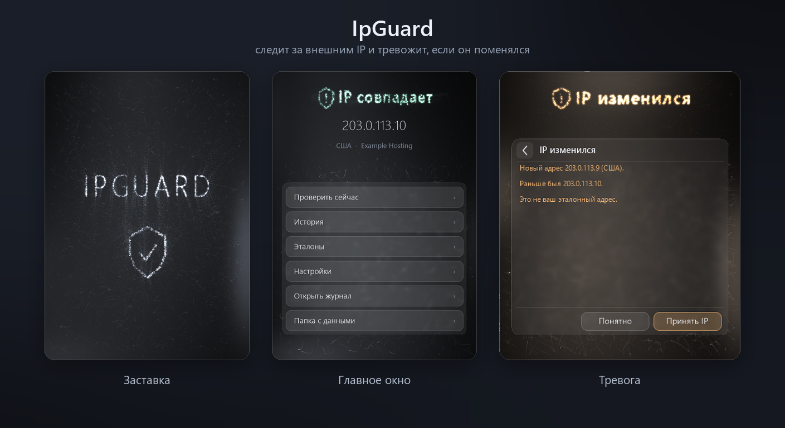
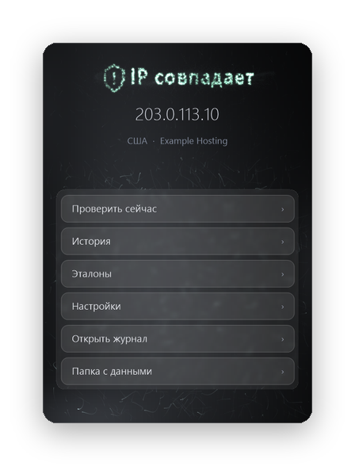
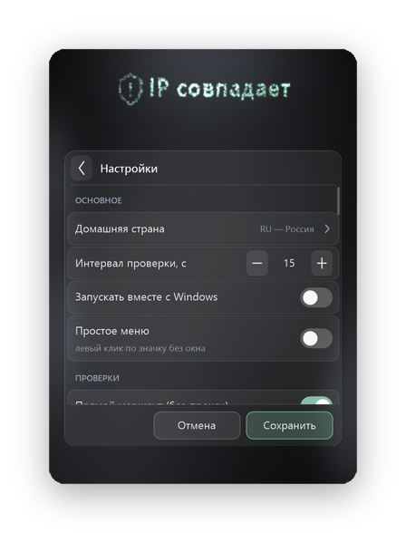
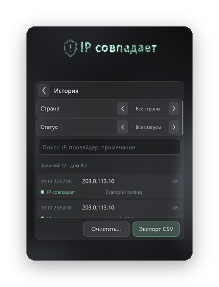
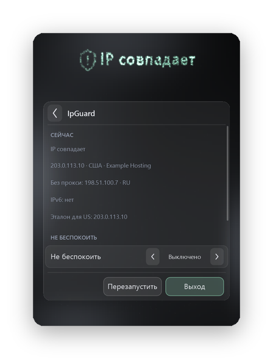
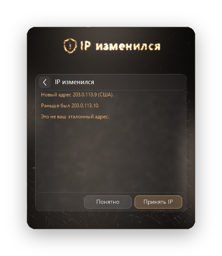
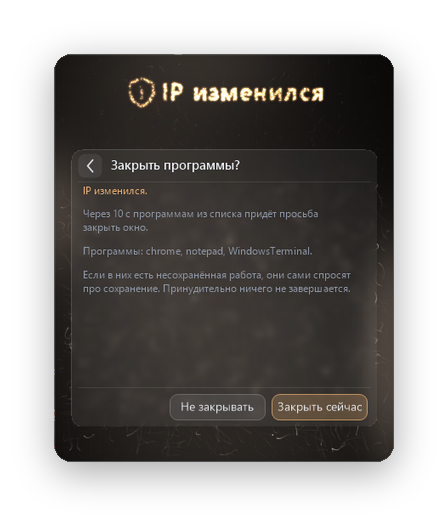
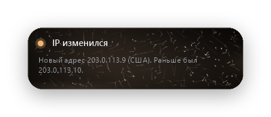

# IpGuard



Программа для трея Windows. Следит за внешним IP-адресом и сразу сообщает, если он изменился, отключился VPN или трафик пошёл мимо него.

## Что умеет

- Определяет внешний IP, страну и провайдера. Сервисы опрашиваются по очереди (2ip.io, ipwho.is, ipinfo.io, ifconfig.co). Сервис, ответивший лимитом или отказом, пропускается на 30 минут.
- Сравнивает адрес с эталонами, которые вы задаёте сами. Эталоны хранятся по странам, у одной страны может быть несколько адресов с подписями.
- Ищет утечки: адрес программ без прокси, когда VPN работает как системный прокси, и IPv6 мимо VPN. Если прокси перестал отвечать, а интернет напрямую есть, это тоже тревога.
- Проверяет адрес при запуске, после сна, при смене сети и по таймеру (по умолчанию каждые 15 секунд).
- Считает время без связи. Если связи нет дольше выбранного времени (по умолчанию 30 секунд), приходит уведомление, а потеря связи записывается в историю.
- При опасных событиях сама открывает окно тревоги и повторяет звук, пока вы не ответите. Фокус окно не забирает.
- Ведёт историю проверок и журнал.

## Окно

<p>



</p>

**Левый клик** по значку открывает окно: заставка, текущий статус, адрес, страна, провайдер и меню. В нём же открываются история, журнал, эталоны и настройки. Управлять можно мышью и с клавиатуры: стрелки, Tab, Enter, Esc. Клик вне окна закрывает его.

**Правый клик** открывает краткую сводку: статус и адреса маршрутов, режим «Не беспокоить» на 15, 30 или 60 минут, версия, проверка обновлений, кнопки «Перезапустить» и «Выход». «Не беспокоить» отключает звуки и уведомления, но окно тревоги при смене IP и утечке всё равно появится.

<p>



</p>

**Тревога.** Когда IP отличается от эталона или найдена утечка, у значка сама открывается панель в тревожном цвете. При смене IP в ней есть кнопка «Принять IP»: она добавляет текущий адрес в эталоны. «Понятно» закрывает панель. Звук повторяется, пока вы не ответите. Если адрес вернулся в норму, панель сообщает «Снова всё в порядке».

**Уведомления** приходят в том же стиле, у значка в трее. Когда Windows занята полноэкранным приложением, показывает презентацию или включена фокусировка внимания, вместо них приходит обычное уведомление системы.



## Значения цвета

| Цвет | Что значит |
|---|---|
| Зелёный | IP совпадает с эталоном |
| Красный | IP отличается от эталона или найдена утечка мимо VPN |
| Оранжевый | VPN отключился или для страны ещё нет эталона |
| Синий | VPN не подключён, вы в домашней стране |
| Серый | Нет связи |

## Установка

1. Скачайте `IpGuard.exe` со страницы [Releases](../../releases).
2. Запустите. Программа появится в трее, установка не нужна.
3. В настройках включите «Запускать вместе с Windows», если нужно.

Нужна Windows 10 или 11, 64-бит. `IpGuard.exe` (около 70 МБ) работает сразу. `IpGuard-light.exe` (около 3 МБ) делает то же самое, но требует [.NET 8 Desktop Runtime](https://dotnet.microsoft.com/download/dotnet/8.0).

## Настройки

- Домашняя страна. Её можно выбрать из списка или одной кнопкой сделать домашней текущую.
- Интервал проверки: от 15 секунд до часа.
- Проверки утечек: прямой маршрут без прокси и IPv6.
- Когда сообщать о потере связи: сразу, через 15, 30 или 60 секунд.
- Окно тревоги. Если выключить, тревоги приходят уведомлением.
- Звуки: громкость и свой звук для пяти событий (готов, IP изменился, VPN отключился, эталон не задан, нет связи). Кнопка «Проверить тревогу» показывает тревогу без смены IP.
- Статус для скриптов по локальному адресу.
- Проверка обновлений раз в сутки. Программа только сообщает о новой версии, сама ничего не скачивает.
- Резервная копия: сохранить настройки и эталоны в файл и загрузить обратно.
- Защита (по умолчанию выключена, при включении просит подтверждение).
- Простое меню: левый клик ничего не открывает, двойной клик показывает историю.

Изменения применяются кнопкой «Сохранить».

## Защита

При опасной ситуации программа может попросить закрыться выбранные программы. Срабатывает при красной тревоге и, если включить, при потере связи дольше заданного времени. Перед закрытием в окне идёт обратный отсчёт (по умолчанию 10 секунд) с кнопками «Закрыть сейчас» и «Не закрывать». Программам посылается обычная просьба закрыть окно: несохранённую работу они спросят сами, принудительно ничего не завершается. Системные программы и саму IpGuard добавить нельзя.

## Для скриптов

Состояние всегда записывается в `%AppData%\IpGuard\status.json`. Если включить это в настройках, оно также доступно только с этого компьютера:

| Адрес | Ответ |
|---|---|
| `http://127.0.0.1:47831/status` | JSON с состоянием |
| `http://127.0.0.1:47831/ok` | 200 и `ok`, если IP совпадает с эталоном, иначе 503 |

Порт меняется в настройках. Поля JSON: `ok`, `state`, `title`, `message`, `ip`, `countryCode`, `country`, `provider`, `references`, `leak`, `updatedUtc`, `version`, в ответе по адресу ещё `ageSeconds`.

```powershell
$status = Invoke-RestMethod http://127.0.0.1:47831/status
if (-not $status.ok) { Write-Error "Запуск отменён: $($status.title)"; exit 1 }
& "C:\Path\To\program.exe"
```

```bash
curl -fs http://127.0.0.1:47831/ok > /dev/null || exit 1
```

## Данные

Всё хранится в `%AppData%\IpGuard`: настройки, эталоны и история, журнал `log.txt`, `status.json` и папка `backups`. Перед каждой записью сохраняется предыдущая версия файла, а при сохранении не чаще раза в два часа делается копия, хранятся последние 12. Повреждённый файл программа восстановит сама. Переменная окружения `IPGUARD_DATA_DIR` с полным путём задаёт другую папку для данных.

## Приватность

Программа обращается только к сервисам определения IP (2ip.io, ipwho.is, ipinfo.io, ifconfig.co, api6.ipify.org) и к `api.github.com` за номером последней версии: сама раз в сутки и по кнопке «Проверить обновления». Данные остаются на вашем компьютере.

## Сборка из исходников

Нужен [.NET 8 SDK](https://dotnet.microsoft.com/download/dotnet/8.0).

```bash
dotnet publish src/IpGuard -c Release -r win-x64 --self-contained -p:PublishSingleFile=true -p:EnableCompressionInSingleFile=true -o dist
```

Лёгкая сборка, которой нужен установленный .NET 8 Desktop Runtime:

```bash
dotnet publish src/IpGuard -c Release -r win-x64 --self-contained false -p:PublishSingleFile=true -o dist-light
```

## Лицензия

MIT, см. [LICENSE](LICENSE).
